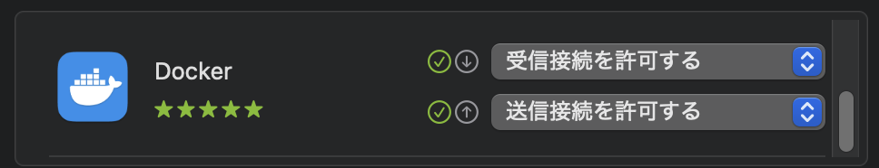
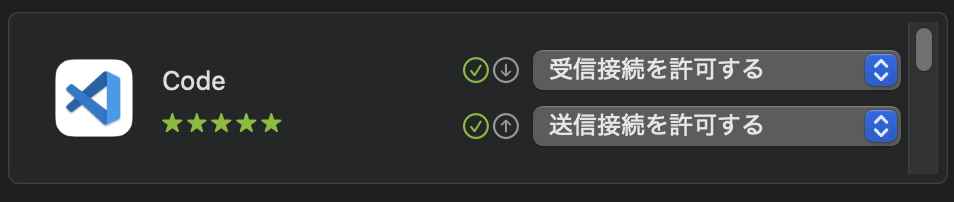

# Dev Containers Configuration - VSCode

## Table of Contents <!-- omit in toc -->

- [Troubleshooting](#troubleshooting)
  - [Unable to connect to TCP port=5000 on macOS](#unable-to-connect-to-tcp-port5000-on-macos)
  - [Empty reply from server before connecting to nginx](#empty-reply-from-server-before-connecting-to-nginx)
  - [Empty reply from server before connecting to Flask (app server?)](#empty-reply-from-server-before-connecting-to-flask-app-server)

## Troubleshooting

### Unable to connect to TCP port=5000 on macOS

macOS では TCP port=5000 は Sequoia 15.1.1 で使用されているようです。
他を当たりましょう。

```console
% lsof -i:5000

COMMAND   PID  USER   FD   TYPE             DEVICE SIZE/OFF NODE NAME
ControlCe 591 akira   10u  IPv4 0xdf59e5f5ee938f1d      0t0  TCP *:complex-main (LISTEN)
ControlCe 591 akira   11u  IPv6 0x86f831f7b79a8621      0t0  TCP *:complex-main (LISTEN)
```

### Empty reply from server before connecting to nginx

```console
% curl http://localhost:80

curl: (52) Empty reply from server
```

SSLでは別のエラーになる

```console
% curl https://localhost:443 

curl: (35) Recv failure: Connection reset by peer
```

ESET Cyber security を使用している場合ファイアーウォールに阻まれまれるようです。  
アプリケーションルールへ Docker.app を追加する必要があるようです。

設定 > ファイアーウォール > アプリケーションルール

<!-- markdownlint-disable-next-line MD033 -->


<!-- spell-checker: words ESET -->

### Empty reply from server before connecting to Flask (app server?)

```console
# curl -v http://localhost:5001

* Trying [::1]:5001...
* connect to ::1 port 5001 from ::1 port 54675 failed: Connection refused
* Trying 127.0.0.1:5001...
* Connected to localhost (127.0.0.1) port 5001
 ...

curl: (52) Empty reply from server
```

こんどは ESET Cyber security のアプリケーションルールへ Code.app を追加する必要があるようです。

設定 > ファイアーウォール > アプリケーションルール

<!-- markdownlint-disable-next-line MD033 -->

