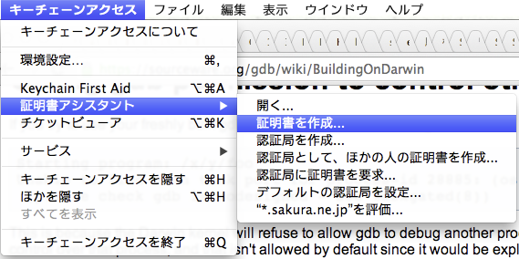
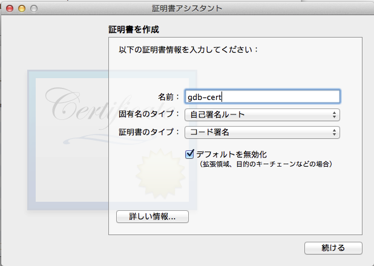
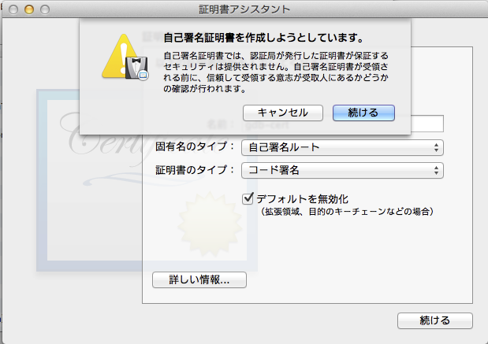
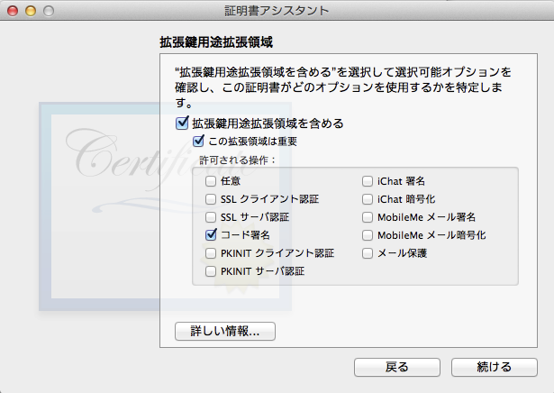
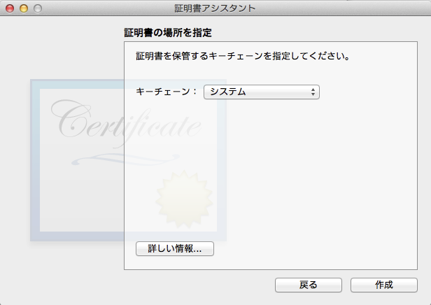
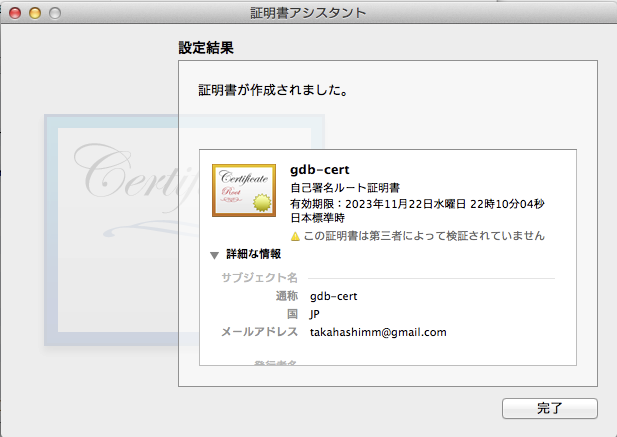
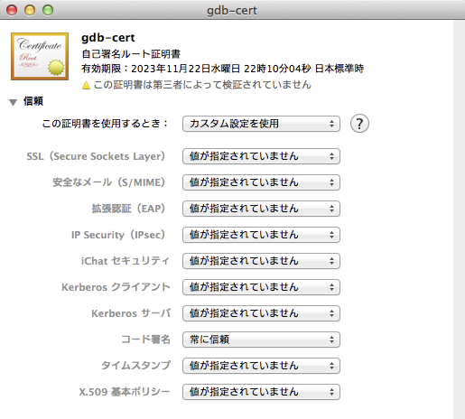

# Homebrew Tips of Code-sign the application

## Table of Contents <!-- omit in toc -->

- [Overview](#overview)
- [Environments](#environments)
- [Create Self-signed Certificate](#create-self-signed-certificate)
  - [Step 1 - Keychain Access](#step-1---keychain-access)
  - [Step 2 - Certificates Info](#step-2---certificates-info)
  - [Step 3 - Extended Key Usage](#step-3---extended-key-usage)
  - [Step 4 - Certificate Location](#step-4---certificate-location)
  - [Step 5 - Result](#step-5---result)
  - [Change Certificate Trust Settings](#change-certificate-trust-settings)
  - [Restart taskgated](#restart-taskgated)
- [Code Signing](#code-signing)
  - [Execute codesign](#execute-codesign)

## Overview

最近の OS X ではそのまま起動しようとすると以下の様なエラーが出て、実行できない場合があります。

<!-- spell-checker: disable -->
```console
(gdb) run
Starting program: /Users/maki/tmp/a.out
Unable to find Mach task port for process-id 910: (os/kern) failure (0x5).
(please check gdb is codesigned - see taskgated(8))
```
<!-- spell-checker: enable -->

ソースから Homebrew を介してインストールされた実行可能ファイルとライブラリはコード署名されていません。
コードはユーザーのマシンでコンパイルされるため、これは理にかなっています。

これは通常大きな問題ではありませんが、他のソフトウェアがインストールされた製品の整合性を検証しようとすると邪魔になります。
また、Homebrew を介してインストールされた実行可能ファイルが変更されたか、他のものと置き換えられたかどうかを確認する簡単な方法はありません。
署名はユーザーのマシンでのみ受け入れられ、それ以外は受け入れられないため、自己生成された署名 ID を使用すれば十分です。これは brew コマンドでインストールした後、codesign コマンドを使用することで実現することができます。

## Environments

- 2017-08-14: Homebrew 1.3.1 on maxOS X 10.11

## Create Self-signed Certificate

### Step 1 - Keychain Access

まず、「キーチェーンアクセス」を開きます。

```zsh
% open -a "Keychain Access.app"
```

「キーチェーンアクセス」メニューの「証明書アシスタント」から「証明書を作成...」を選択します。

<!-- markdownlint-disable-next-line MD033 -->


### Step 2 - Certificates Info

名前を適当につけ（ここでは gdb-cert にしています）、「自己署名ルート」「コード署名」を選択し、「デフォルトを無効化」にチェックを入れます。

<!-- markdownlint-disable-next-line MD033 -->


「続ける」ボタンを押します。
警告が出ますが、そのまま進みます。

<!-- markdownlint-disable-next-line MD033 -->


「続ける」ボタンを押します。

### Step 3 - Extended Key Usage

拡張鍵用途選択領域では「コード署名」にチェックを入れます。

<!-- markdownlint-disable-next-line MD033 -->


「続ける」ボタンを押します。

### Step 4 - Certificate Location

証明書の場所を指定では「システム」を選択します。

<!-- markdownlint-disable-next-line MD033 -->


「作成」ボタンを押します。

### Step 5 - Result

これでコード署名用の自己署名証明書が作られます。

<!-- markdownlint-disable-next-line MD033 -->


「完了」ボタンを押します。

### Change Certificate Trust Settings

さらに、作成された証明書をダブルクリックで開いて、「信頼」を開き、コード署名のところを「常に信頼」にします。

<!-- markdownlint-disable-next-line MD033 -->


### Restart taskgated

ここで証明書を閉じて、キーチェーンアクセスを終了します。
そして、taskgated をいったん終了させて、再起動させます。

```zsh
ps aux | grep taskgated
sudo kill {pid}
```

## Code Signing

### Execute codesign

GDB にコード署名します。

```zsh
sudo codesign -s gdb-cert /usr/local/bin/gdb
```
