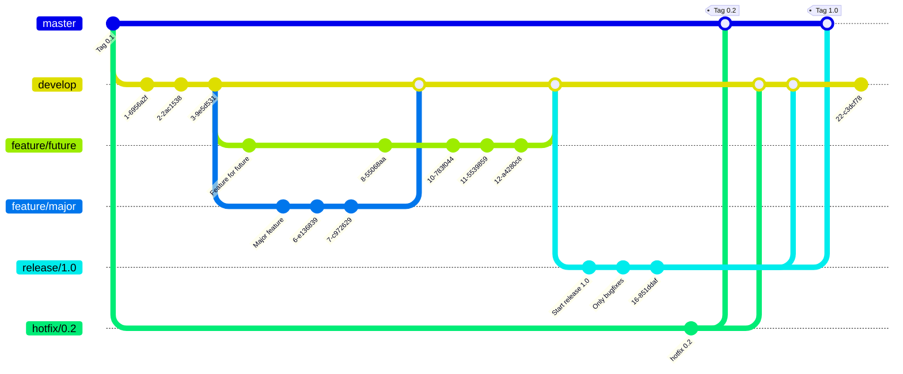

# Git Flow

## Table of Contents <!-- omit in toc -->

- [Overview](#overview)
- [Git Flow Example](#git-flow-example)
- [References](#references)

## Overview

Vincent Driessen proposes "A successful Git branching model" as a development model that utilizes Git branches.

- [A successful Git branching model](https://nvie.com/posts/a-successful-git-branching-model/)

There are also antis.

## Git Flow Example

| Repository configuration | Description |
| :-: | :-: |
| master | Holds the HEAD of released source code. Once the develop source code is stable, create a Release branch and prepare for release. Once a release is ready, it will be merged from the Release branch into master and tagged with a release number. |
| develop | Main branch for development. Keep the HEAD of the latest source code for the next release. Sometimes called an "integration branch," this is also the source for automated builds. |
| feature/xxxx | Branches for implementing major features. Create a Feature branch for each task, such as implementing a feature or fixing a bug. Basically, derive from develop and merge into develop. I will eventually delete it when I'm done using it. |
| release-\* | Branches for preparing for release. By creating a Release branch, you can separate code for release preparation and development for the next version. Be sure to derive from develop and merge into master and develop. I will eventually delete it when I'm done using it. |
| hotfix-\* | Branch for making emergency fixes to released software. Fixes in this branch are released immediately, so the hotfix branch is merged into the master branch that manages releases. I will eventually delete it when I'm done using it. |

## References

- [FeatureBranch - Martin Fowler](https://martinfowler.com/bliki/FeatureBranch.html)
